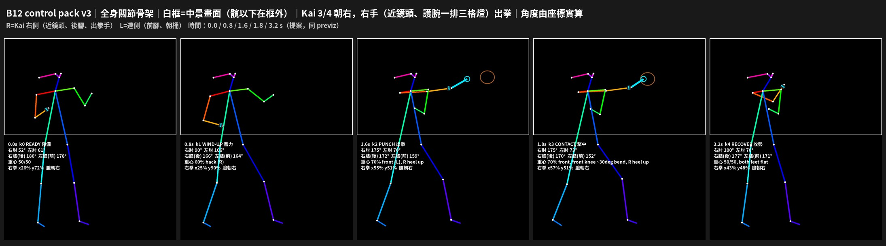
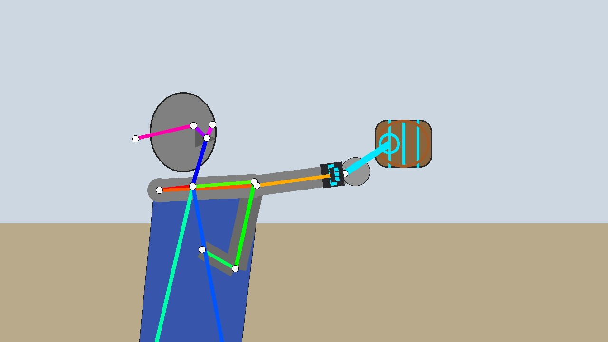

# AI Film Production — A Working System for Making Films with AI Agents

**一套用 AI Agent 做影片的完整製作系統：方法、分工、故事理論、常備知識，與人工核准關卡。**

This repository is a complete, field-tested production system for making AI films with agent teams. It is not a prompt collection and not a tutorial. It is the operating system one team actually uses: the production method, the role establishment, the story-theory layer, the standing knowledge every working agent must carry, and the human approval gates that keep a person in charge of the creative decisions.

這不是提示詞合集，也不是教學文。這是一支團隊真正在用的製作系統，從真實案子裡長出來：真人品牌片、長篇敘事片（寫實兒童主角與授權卡通角色共演）、產品與展示片，再加上 2026 年 11 月與另一支 Agent 團隊進行的 20 輪最佳實務交流。每條規則都標了證據等級：量過的、對過原始檔案的、只有書面紀錄的、還是慣例與未實測提案，引用時照等級拿捏，不把慣例當量測。

## What is inside / 內容總覽

| Layer 層 | Folder 資料夾 | What it does 它做什麼 |
|---|---|---|
| Method 方法 | `skills/ai-film-production-workflow/` | The production method in five parts: core method, field lessons, casting supplements, dialogue-film overrides, and 91 evidence-graded best practices. 製作方法五部：核心方法、現場經驗、選角增補、對白片覆寫規則、91 條附證據等級的最佳實務。 |
| Team 分工 | `skills/ai-film-team-roles/` | Seven roles with owns / never-does / outputs, scaling rules, the standing knowledge kit (§9), and the human approval gates (§8). 七個角色的權責、縮編規則、常備知識包（§9）、人工核准關卡（§8）。 |
| Story 故事 | `skills/story-screenwriting-theory/` | 1,114 theory cards with an intake protocol and a diagnosis flow. Story is settled here before production begins. 1,114 張理論卡、進案協議與診斷流程；故事在這一層定案，才進製作層。 |
| Support 支援 | `supporting-skills/` | Four cross-cutting skills: paid-spend authorisation, specialist analysis with independent QC, scoped build coverage, long-file delivery integrity. 四支跨領域支援 Skill：付費授權、專家分工與獨立 QC、範圍覆蓋、長檔交付完整性。 |
| Knowledge 知識 | `knowledge/` | The standing knowledge kit: TECH-39 (100 named image-processing techniques), TECH-21 (ffmpeg measurement discipline), TECH-34 (huashu-motion directing method), TECH-35 (HyperFrames knowledge card), and the model appendix with verified per-model behaviours. 每個工作 Agent 必備的知識層：映像處理 100 選、ffmpeg 量測紀律、合成片導演方法、HyperFrames 知識卡、模型附錄。 |
| Door 入口 | `START-HERE_交接說明.md` | The entry file. Read this first; it maps everything and states the authority order when files seem to conflict. 入口檔：先讀這份，裡面有完整地圖與衝突時的權威次序。 |
| Citations 出處 | `knowledge/引用與出處_How-to-Cite.md` | How to cite the attached TECH dossiers, where they come from, and where this package lives. 附上資料的引用方式、出處與本包位置。 |
| Manifest 清單 | `MANIFEST.json` | Every file with size and SHA-256, for verifying a copy is complete and unmodified. 每個檔案的大小與指紋，驗證副本完整性用。 |

## How to use it / 怎麼用

You need an agent environment that loads skills (this system was built for Muse; the files are plain Markdown and portable).

1. Place the three core folders from `skills/` into your skills directory, keeping folder names unchanged. Put `supporting-skills/` there too if you want them, and keep `knowledge/` beside them.
2. Read `START-HERE_交接說明.md`, then `skills/ai-film-production-workflow/SKILL.md` in full. Load reference parts only as the core directs (Part 4 only for dialogue films, Part 2 for product or UI films, and so on).
3. For story work, go through `story-screenwriting-theory` first and hand fixed specs to the production layer.
4. If you spawn sub-agents, assign work by `ai-film-team-roles`, and attach each role's §9 knowledge items to its dispatch. A dispatch without its knowledge is an incomplete dispatch.
5. Run the human approval gates (§8 of team-roles) before any video generation. See below.

使用環境需要能載入 Skill（本系統為 Muse 而建；檔案都是純 Markdown，可移植）。步驟：核心三支放進你的 skills 目錄、資料夾名不要改；先讀入口檔，再讀 workflow 核心；故事先走理論層；派工照 team-roles，並把 §9 的知識附給對應角色；生成前先過 §8 的人工關卡。

## Worked example: drawing the motion before generating it / 示範：先畫動作，再生成

Shot B12 (a punch, from a family action film) shows Part 2 §2.16 end to end. The motion was drawn in code first, as a joint-skeleton control pack whose angles, weight shifts and fist positions are computed from one coordinate set; generation came last and followed the drawing.

這一鏡（B12，出拳）是 Part 2 §2.16 的完整示範：先用程式畫出關節骨架 control pack，角度、重心、出拳位置全部由同一組座標實算；生成是最後一步，照著圖打。

**Step 1 — the control pack.** Five keyposes (READY 0.0 s, WIND-UP 0.8 s, PUNCH 1.6 s, CONTACT 1.8 s, RECOVER 3.2 s). The white rectangle is the shot's frame (a medium shot; hips and below are drawn but sit outside it). Under each keypose: elbow and knee angles, weight split, and the fist's position in percent coordinates. The wrist device is drawn on the punching wrist; the target is the circle at the contact point.

**Step 2 — the dressed previs.** The skeleton composited over the scene plate, with the barrel placed at the exact contact point. This is the bridge image the photographic keyframe is aimed at.

**Step 3 — the generated frame.** The generator followed the drawing: same arm, same contact point, same wrist device, barrel at the drawn position. When a take misses, the fix goes back to Step 1's numbers, not to more adjectives in the prompt.

(The generated frame itself is not published in this package: it is a photoreal image of a real child. It matched the drawing on the same arm, the same contact point and the same wrist device. 生成結果圖不在本包公開，因為它是真實孩童的寫實影像；它與圖面一致：同一隻手、同一個接觸點、同一個護腕位置。)

生成結果跟著圖走：同一隻手、同一個接觸點、同一個護腕位置。Take 不對時，回去改 Step 1 的數字，不是在 prompt 裡加形容詞。The detailed procedure is Part 2 §2.16 of the workflow; the companion implementation on the Grok team's side is the `previs-and-motion-guides` skill in [production_grok](https://github.com/fayekai2013/production_grok), where a shared Python build script for these packs is in preparation.

## The mechanisms that matter / 核心機制

**Gates, not vibes.** Production moves through gates (photo gate, locked character sheets, pilot of the hardest shot first, per-shot QC verdicts). A FAIL stops that shot until it is fixed or kept under a numbered waiver with a reason and an approver. Deviations are always written, never verbal.

**Human approval gates (F1–F5).** The person in charge personally approves, before any video generation: F1 the script package (script, shot-by-shot details, every VO line); F2 the character package (settings and locked sheets); F3 the keyframe package (every cut's start and intermediate frames); F4 the pre-generation board (every shot's image with its VO text and duration printed on the image); F5 generation release, only when F1–F4 are all approved. Any paid API use is disclosed before it runs. Final delivery acceptance is separate and comes after.

**One shot table.** Script, previs, prompts and QC all derive from a single shot table. Nothing is redrawn independently downstream.

**Evidence grades.** Part 5's 91 practices carry grades: A (verified by recomputation), B (verified against source files), C (written record only), D (convention or untested proposal). A C-grade rule is a claim, not a measurement, and the system says so on its face.

**Model appendix.** The method body stays model-agnostic. Per-model facts (reference limits, filter behaviour, likeness distributions, prices) live in the appendix in `knowledge/`, one row per model, dated and sourced; thresholds are calibrated per pipeline from the project's own baselines, never copied as absolutes.

**Numbers are recomputed, not repeated.** Any load-bearing number must be recomputable from its raw file; anything else is labelled unverified. Delivered files are measured themselves (specs, loudness, ASR), never assumed from their sources.

## Adaptation / 調整預設

Two defaults reflect the originating team's context and are marked where they live: loudness defaults to −16 LUFS (−14 only for confirmed phone/social-first delivery), and gates may hold a shot until fixed or formally waived. If your context differs, change the default in one place, write down that you changed it, and keep the rest of the system intact. The evidence grades tell you which rules are measured and safe to lean on, and which are conventions you may reasonably re-test first.

## Version / 版本

- v2.1, 2026-11-18: knowledge layer (§9 standing kit) and the F1–F5 human approval gates added; team-roles at v1.1.
- v2.0, 2026-11-18: first handoff package (three core skills, four supporting skills, entry file, manifest).
- The canonical source is the maintainer's local skill library; this repository is the distribution snapshot. When the source advances, this repo is re-exported rather than edited in place.

正本在維護者的本機 Skill 庫；這個 repo 是對外發行快照。正本進版時整包重新匯出，不在 repo 內零碎改。

## Who made this / 出處

Built and maintained by the author's team, from productions delivered in 2025–2026 and a 20-round best-practice exchange with a second agent team in November 2026. Shared so another Muse user can run the same system end to end: read the door file, load by the map, keep the gates.

由作者的團隊建立與維護，出自 2025–2026 年實際交付的案子，以及 2026 年 11 月與另一支 Agent 團隊的 20 輪最佳實務交流。分享出來，是讓另一位 Muse 使用者能整套照著跑：讀入口、照地圖載入、守住關卡。
